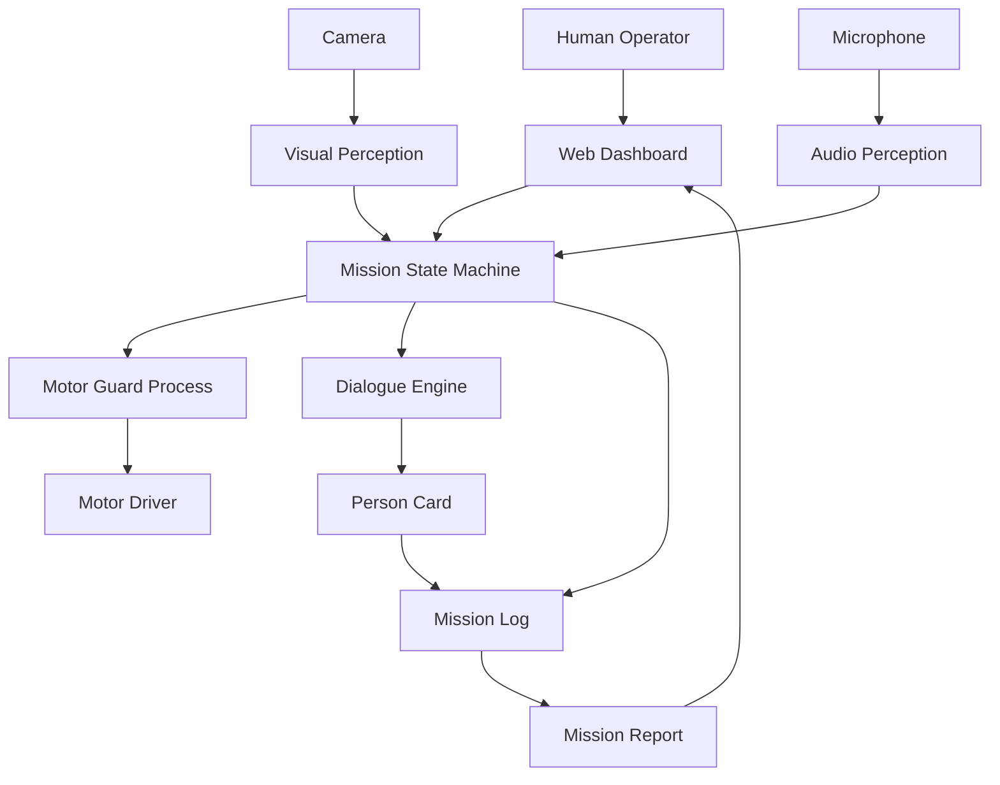

# A Robot That Can Be Lost, So That a Person Does Not Have To

### Low-Cost AI Scout Robot for First Contact in Hazardous Areas

> **A robot can be replaced. A human life cannot.**

An experimental, low-cost ground robot designed to explore potentially hazardous environments, detect people who may need assistance, establish basic verbal contact, and provide a human operator with a structured situation report.

The central research question is simple:

**How much intelligence can software add to a robot built for less than €150?**

**Project status:** Active research prototype  
**Hardware target:** €120–150  
**Platform:** Raspberry Pi 5 (4 GB)  
**AI processing:** Local, on-device  
**Demonstration:** KI-Con, January 11, 2027

---

## 1. Why This Project Exists

After shelling, accidents, or structural damage, rescue workers may need to enter unfamiliar and potentially dangerous environments without knowing whether someone is injured, trapped, or unable to respond.

Sometimes, the first task is simply to gather information.

This project explores whether a small, affordable robot can perform part of that initial observation and communication work without exposing another person to unnecessary danger.

Instead of developing an expensive, complex rescue platform, the goal is to investigate what can be achieved using accessible electronics, 3D printing, and efficient local AI models.

**Affordability is a design requirement, not an afterthought.**

The project is a research prototype, not a certified rescue device or a system ready for real emergency deployment.

---

## 2. The Five AI Capabilities

The system is organized around five connected capabilities.

| Capability | Purpose |
|---|---|
| **01 · SEE** | Detect people, including those lying down or partially obscured, using an adapted YOLO model. |
| **02 · HEAR** | Identify voice activity and potentially relevant sounds such as knocking or groaning, even when the camera cannot see a person. |
| **03 · TALK** | Establish basic verbal contact in English or German through local speech recognition, scripted questions, and speech synthesis. |
| **04 · UNDERSTAND** | Combine visual observations, audio events, and dialogue facts into an explainable person card with a priority indicator. |
| **05 · REMEMBER** | Record mission events, observations, and supporting evidence to generate a concise mission report. |

The robot observes and communicates. It does not diagnose injuries or make evacuation decisions.

A human operator remains responsible for interpreting its findings.

---

## 3. How a Mission Works

The robot is remotely operated through a browser-based dashboard.

A typical mission follows this sequence:

1. **Explore:** The operator drives the robot through a controlled environment using live video.
2. **Detect:** The perception system identifies a person or potentially relevant sound.
3. **Stop:** The robot stops before initiating computationally intensive processing.
4. **Observe:** Vision and audio provide additional information about the situation.
5. **Contact:** The robot attempts a short, structured conversation in the detected language.
6. **Record:** Observations and reported facts are saved together with their evidence.
7. **Report:** The operator receives a person card and a summary of the mission.

### Stop and Think

The system follows a resource-aware principle:

**Move when necessary. Stop when deeper processing is required.**

Computationally expensive models are scheduled while the robot is stationary whenever possible.

This reduces motor noise during speech recognition and makes it easier to manage the limited CPU, memory, and power budget of the Raspberry Pi.

---

## 4. System Architecture

The architecture separates the user interface, hardware control, perception, conversation, and reporting.



The mission state machine coordinates movement, observation, communication, and reporting.

Safety-related motor control is kept separate from computationally expensive AI tasks.

The initial software motor guard provides process-level separation. Full protection against an operating-system or hardware failure requires additional hardware safeguards.

---

## 5. Hardware

The platform uses inexpensive, widely available components.

| Component | Role |
|---|---|
| Raspberry Pi 5, 4 GB | Main processing unit |
| 3D-printed chassis | Low-cost mobile platform |
| Four DC motors | Locomotion |
| L298N motor driver | Motor actuation |
| Camera | Visual perception |
| Microphone | Sound capture and speech input |
| Speaker | Spoken communication |
| Two ultrasonic sensors | Basic obstacle detection |
| Battery and power electronics | Portable operation |
| Accelerometer (optional/integration) | Additional motion information |

The intended hardware budget is below €150.

The final bill of materials, power measurements, and actual costs will be documented as the prototype is completed.

---

## 6. Software Stack

The project is developed primarily in Python.

| Area | Technologies |
|---|---|
| Computer vision | OpenCV, Ultralytics YOLO, NCNN |
| Voice activity detection | Silero VAD |
| Speech recognition | Whisper-type local ASR |
| Sound recognition | AudioSet-based classification |
| Speech synthesis | Local TTS, such as Piper |
| Language understanding | Small quantized LLM or rule-based extraction |
| Control | Python, GPIO, mission state machine |
| Dashboard | Flask, HTML, CSS, JavaScript |
| Logging | Structured JSON Lines |
| Evaluation | Python-based measurement scripts |

Model selection is part of the research.

The final system will use only components that satisfy practical memory and latency constraints.

A scripted dialogue and template-based report are maintained as fallbacks if a local LLM proves impractical.

---

## 7. Getting Started

> The repository is under active development. The commands below describe the intended development workflow and may not yet be functional until the package and hardware integration are complete.

### Requirements

- Raspberry Pi 5 with a compatible 64-bit operating system
- Python 3
- Configured camera and audio devices
- Supported motor controller and sensors
- Local network connection for the operator dashboard

### Development environment

```bash
git clone https://github.com/USERNAME/low-cost-ai-scout.git
cd low-cost-ai-scout

python3 -m venv .venv
source .venv/bin/activate

pip install -e .
```

### Configuration

```bash
cp configs/example.yaml configs/local.yaml
```

Review the local configuration before connecting the motors.

### Application entry point

```bash
python -m scoutbot.main
```

Hardware configuration, service startup, and dashboard access instructions will be finalized after integration testing.

Never operate the motors without a verified emergency-stop mechanism.

---

## 8. Research and Evaluation

This is not only a robotics build. It is an experimental investigation into the practical limits of AI on inexpensive hardware.

### Research Questions

**Person detection**

Can a YOLO model fine-tuned on floor-level images outperform a pretrained model when detecting people who are lying down, partially hidden, or viewed under difficult lighting?

**Audio-based detection**

Can relevant human sounds be distinguished from background and motor noise?

**Human communication**

How reliably can a low-cost robot recognize spoken responses, identify English or German, and extract useful information?

**Evidence-grounded reporting**

Can a person card and mission report represent observed facts without introducing unsupported claims?

**Edge AI performance**

Can these capabilities operate within the Raspberry Pi's RAM, processing, thermal, and battery limitations?

### Evaluation Metrics

| Category | Metrics |
|---|---|
| Vision | Detection rate, false alarms, inference latency |
| Audio | Event detection performance under motor noise |
| Speech | Word error rate, language identification accuracy |
| Dialogue | Correctly extracted facts |
| Reporting | Percentage of claims supported by recorded evidence |
| Performance | RAM consumption, latency, temperature, power use |
| Safety | Emergency-stop behavior and connection-loss response |

The initial evaluation design includes approximately 10 scenes containing a person and 10 without a person, with selected scenes held out from training.

Repeated experiments may expand this to approximately 60 test runs.

Volunteer contact experiments will be conducted with informed consent in a controlled indoor environment.

The project does not assume a particular accuracy in advance.

**Unexpected failures and measured limitations are research results, too.**

---

## 9. Person Cards and Mission Reports

The robot collects information from multiple sources and presents it in a compact, explainable format.

An illustrative person card might contain:

```json
{
  "person_id": "P-001",
  "observations": [
    "Person detected lying down",
    "No visible movement for 10 seconds"
  ],
  "reported_facts": [
    "Person reports leg pain"
  ],
  "priority_indicator": "HIGH",
  "evidence": [
    "vision:frame_0142",
    "dialogue:turn_03"
  ]
}
```

This is an example of the intended data structure, not a real experimental result.

A priority indicator represents a configurable rule-based assessment of the available observations. It is not a medical diagnosis.

Every factual claim in a generated mission report should be traceable to recorded evidence in the mission log.

If sufficient information is unavailable, the system should explicitly report uncertainty instead of inventing details.

---

## 10. Safety, Ethics, and Privacy

The prototype is designed for controlled indoor testing.

Its operating principles include:

- The human operator retains control of movement.
- The operator can interrupt a dialogue or trigger an emergency stop.
- The robot does not provide medical advice.
- Missing speech or movement must not be interpreted as proof that no person is present.
- Safety-critical motor stopping must not depend on AI inference.
- Audio recordings, images, and volunteer responses require appropriate consent and data protection.
- Research data containing identifiable people must not be published without permission.

The prototype is not intended for autonomous operation in actual rescue situations.

---

## 11. Development Roadmap

### Phase 1 — Foundation
- [ ] Verify motor safety and power distribution
- [ ] Establish the mission state machine
- [ ] Validate camera and audio operation
- [ ] Benchmark available AI models on the Raspberry Pi

### Phase 2 — Perception
- [ ] Collect and annotate floor-level images
- [ ] Fine-tune and compare YOLO models
- [ ] Integrate voice activity detection
- [ ] Evaluate basic sound event recognition

### Phase 3 — Communication
- [ ] Integrate English and German speech recognition
- [ ] Implement scripted dialogue
- [ ] Add local text-to-speech
- [ ] Evaluate optional LLM-based fact extraction

### Phase 4 — Reporting
- [ ] Implement evidence-backed person cards
- [ ] Record structured mission events
- [ ] Generate a mission report
- [ ] Validate report statements against the log

### Phase 5 — Evaluation and Demonstration
- [ ] Complete indoor scenario testing
- [ ] Measure accuracy, latency, RAM, and power consumption
- [ ] Document observed limitations
- [ ] Prepare a reproducible KI-Con demonstration

Checkboxes represent planned milestones and should be updated when each component is verified.

---

## 12. KI-Con Demonstration

**January 11, 2027**

The planned demonstration uses a small indoor test area with partitions and simulated obstacles.

A visitor controls the robot from behind a screen and receives information only through the dashboard.

The robot attempts to detect a person, establish verbal contact, record available information, and create a compact situation report.

Visitors can modify the lighting, introduce obstacles, or simulate missing responses to explore the limitations of the system.

The demonstration will also present measured evaluation results, failure examples, and a backup video.

---

## 13. Project Documentation

Additional technical and experimental documentation will be available in:

- `docs/architecture.md` — components and communication
- `docs/hardware.md` — electronics, wiring, and power
- `docs/safety.md` — safety assumptions and failure handling
- `docs/experiments.md` — methodology and measurements
- `docs/roadmap.md` — development milestones
- `evaluation/` — experimental protocols and analysis

Large datasets, private recordings, credentials, and model weights are not intended to be committed directly to the public repository.

---

## 14. Project Links

[Project page](https://yelyzavetavdoviuk.netlify.app/robot-project)

Developed as an academic AI and robotics research project.

---

**The goal is not to replace rescuers. It is to explore whether affordable technology can help them obtain information without taking unnecessary risks.**
